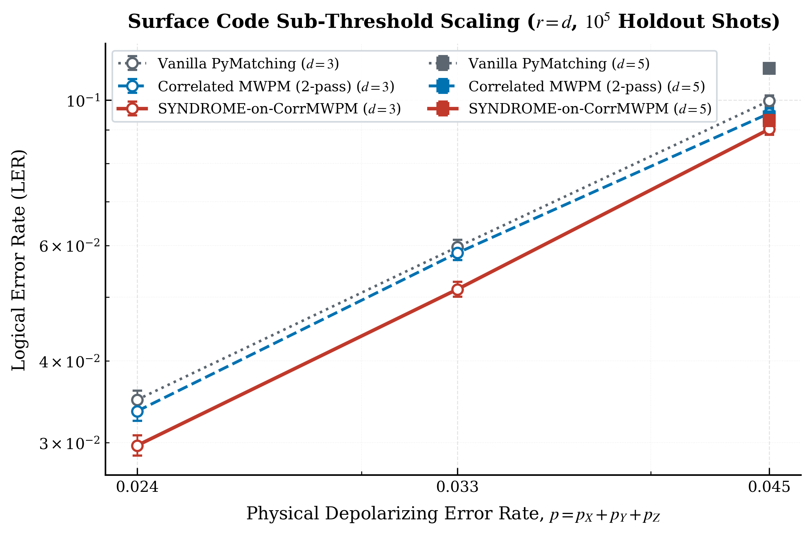
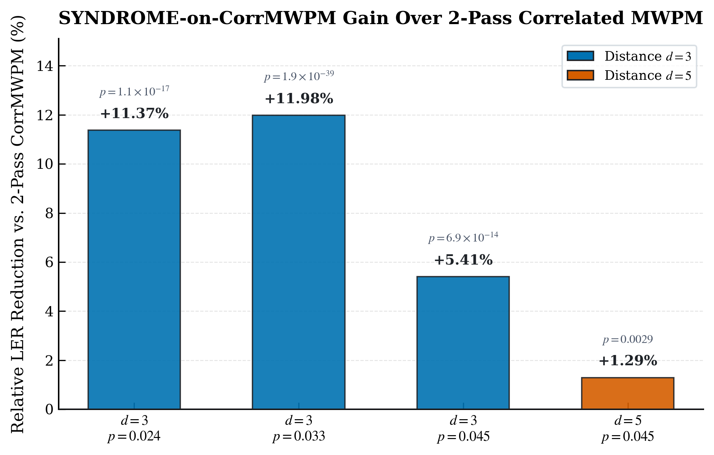

# SYNDROME: Hybrid MWPM + GNN Validity Arbiter for Surface Code Decoding

[](https://www.python.org/)
[](https://pytorch-geometric.readthedocs.io/)
[](https://github.com/quantumlib/Stim)
[](https://github.com/oscarhiggott/PyMatching)

**SYNDROME** is a hybrid Quantum Error Correction (QEC) decoding architecture for rotated planar surface codes. Rather than replacing classical Minimum-Weight Perfect Matching (MWPM) with a monolithic end-to-end neural decoder, SYNDROME formulates a residual edge-aware Graph Neural Network (`GINEConv`) as a **calibrated binary validity arbiter** that audits candidate MWPM matchings on open-boundary syndromes and selectively overrides them only when posterior failure probability exceeds a validation-calibrated threshold.

---

## Core Contributions

1. **Matching-as-Input Validity Arbitration:** Instead of predicting edge weights for Blossom or decoding from raw syndromes alone, SYNDROME ingests the exact candidate matching returned by PyMatching (or 2-pass Correlated MWPM) alongside unchosen physical and $X	ext{–}Z$ correlation edges, learning to detect boundary coset degeneracies and Pass-1 correlation errors.
2. **Localized Virtual Boundary Nodes (Open-Boundary Planar Geometry):** Connecting all perimeter detectors to a single global virtual boundary node causes severe message-passing over-squashing. SYNDROME instantiates dedicated local virtual boundary nodes displaced by `1.0` normalized grid unit along the outward normal vector of each boundary-capable detector, preserving spatial locality across code distances ($d=3, 5$).
3. **Inference-Time Complementary Gap ($\Delta W$) Gating:** Controlled ablations reveal that concatenating Gidney's Complementary Gap ($\Delta W = \vert{}W_1 - W_0\vert{}$) *during training* induces shortcut learning and cuts LER gains in half (`+3.98%` vs. `+8.45%` at $d=3$). Training *without* $\Delta W$ and gating *strictly at inference time* (`q25`) reduces GNN invocations from **`82.6%` to `22.6%`** at $d=5$ (**`2.86×` speedup**) while *improving* Logical Error Rate (`+14.78%` vs. `+14.55%`).
4. **Statistically Significant Gains Over 2-Pass Correlated MWPM:** Stacking SYNDROME on top of Bayesian 2-pass Correlated MWPM yields statistically significant LER reductions across both $d=3$ (up to **`+11.98%`** over CorrMWPM sub-threshold, $p = 1.91 \times 10^{-39}$) and $d=5$ (**`+1.29%`** over CorrMWPM / **`+16.79%`** over Vanilla PyMatching at $p=0.045$, $p = 2.87 \times 10^{-3}$).

---

## Architecture Overview

```text
Raw Syndrome (Stim DEM)
   │
   ▼
Classical Decoder (Vanilla PyMatching or 2-Pass Correlated MWPM)
   │
   ├──► High Complementary Gap (ΔW > cutoff) or Bulk-Only ──► Accept Classical Prediction (~μs)
   │
   ▼
Ambiguous / X-Boundary Syndrome
   │
   ▼
Local Subgraph Construction (1-hop unlit bridges + X-Z DEM correlation edges + localized virtual boundary nodes)
   │
   ▼
Residual GINEConv Arbiter (4 layers @ d=3, 6 layers @ d=5 + LayerNorm Readout Head)
   │
   ▼
Calibrated P(MWPM fails | S, M) >= τ  ──► Flip Logical Observable Prediction
```

### Graph Representation

- **Node Features (7-dim):** Normalized spacetime coordinates `(x, y, t)`, `is_lit`, `is_virtual_boundary`, `is_boundary_capable`, and `is_x_component`.
- **Edge Features (6-dim):** Original DEM log-likelihood weight `w`, Pass-2 Bayesian reweighting shift `Δw`, `crosses_logical`, `is_chosen` (by MWPM), `is_boundary_edge`, and `is_corr_edge` ($X	ext{–}Z$ $Y$-error correlation).
- **Readout Stability:** A `LayerNorm(2 * hidden_dim)` layer precedes the final MLP over `[global_add_pool, global_mean_pool]` to prevent additive pooling magnitude explosion and dead-neuron saturation on larger $d=5$ graphs.
- **Calibration & Zero Leakage:** Models are trained with unweighted `BCEWithLogitsLoss` on a disjoint training split; the override threshold $\tau$ is selected strictly on a held-out validation split before touching the separately seeded (`seed=2026`) 100,000-shot holdout set.

---

## Benchmark Results

All benchmarks evaluate **100,000 fresh holdout shots** (`seed=2026`) on Stim `surface_code:rotated_memory_x` ($r = d$) under isotropic depolarizing noise ($p_X = p_Y = p_Z = p_{\text{meas}} = p/3$). Significance is computed via exact two-sided McNemar binomial tests on discordant pairs (`TP` fixed vs. `FP` broken).

### 1. SYNDROME-on-CorrMWPM (Stacked Over 2-Pass Correlated MWPM)

| Distance & Noise | Vanilla PyMatching LER | 2-Pass CorrMWPM LER | **SYNDROME-on-Corr LER** | vs. Vanilla | vs. CorrMWPM | Overrides (TP / FP / Prec) | McNemar $p$ (vs. Corr) |
| :--- | :---: | :---: | :---: | :---: | :---: | :---: | :---: |
| **$d=3, p=0.024$** | `0.03488` | `0.03351` | **`0.02970`** | `+14.85%` | **`+11.37%`** | `1,181` / `800` (`59.6%`) | `1.09e-17` |
| **$d=3, p=0.033$** | `0.05966` | `0.05842` | **`0.05142`** | `+13.81%` | **`+11.98%`** | `1,779` / `1,079` (`62.2%`) | `1.91e-39` |
| **$d=3, p=0.045$** | `0.09973` | `0.09542` | **`0.09026`** | `+9.50%` | **`+5.41%`** | `2,627` / `2,111` (`55.4%`) | `6.93e-14` |
| **$d=5, p=0.024$** | *In progress* | *In progress* | *In progress* | — | — | — | — |
| **$d=5, p=0.033$** | *In progress* | *In progress* | *In progress* | — | — | — | — |
| **$d=5, p=0.045$ (Full)** | `0.11179` | `0.09424` | **`0.09302`** | **`+16.79%`** | **`+1.29%`** | `885` / `763` (`53.7%`) | `2.87e-03` |
| **$d=5, p=0.045$ ($\Delta W$ q25)** | `0.11179` | `0.09424` | **`0.09338`** | `+16.47%` | **`+0.91%`** | `705` / `619` (`53.2%`) | `1.95e-02` |

### 2. SYNDROME-on-Vanilla & Complementary Gap ($\Delta W$) Ablation ($p = 0.045$)

| Configuration | Vanilla LER | SYNDROME LER | Relative Gain | Routing Rate | Total Latency| McNemar $p$ |
| :--- | :---: | :---: | :---: | :---: | :---: | :---: |
| **$d=3$, X-Boundary (No $\Delta W$ in training)** | `0.09973` | **`0.09130`** | **`+8.45%`** | `49.8%` | `214.6` | `3.07e-42` |
| **$d=3$, $\Delta W$ Fed During Training (Ablation)** | `0.09973` | `0.09576` | `+3.98%` *(shortcut learning)* | `20.9%` | `102.6` | `1.45e-06` |
| **$d=5$, Full X-Boundary Routing** | `0.11179` | `0.09553` | `+14.55%` | `82.6%` | `1,084.0` | `1.63e-97` |
| **$d=5$, Inference-Only $\Delta W$ q25 Gating** | `0.11179` | **`0.09527`** | **`+14.78%`** | **`22.6%`** | **`379.1` (`2.86×` faster)** | `2.06e-109` |

### 3. Biased-Noise Control Experiment ($d=3, \eta=100, p_Z=0.02$)

Under strongly $Z$-biased noise on a standard CSS `rotated_memory_x` circuit (where $Y$-error $X	ext{–}Z$ correlations are suppressed by $100\times$), SYNDROME produced a clean null result (`0.05195` $\rightarrow$ `0.05162`, `+0.64%`, $p = 0.2641$), confirming that standalone MWPM already operates near the exact Maximum-Likelihood limit on a $3 \times 3$ CSS lattice without $X	ext{–}Z$ correlations.

---




## Repository Structure

```text
syndrome/
├── notebooks/                  # Google Colab end-to-end training & benchmarking pipelines
├── results/                    # Verified 100k-shot holdout JSONs, calibration sweeps & checkpoints (*.pt)
│   ├── SWEEP_SUBTHRESHOLD_v1/  # d=3 and d=5 sub-threshold scaling sweep artifacts
│   └── figures/                # Log-log threshold scaling and relative gain plots
├── .gitignore                  # Excludes multi-GB regenerating graph caches (train_graphs.pt / val_graphs.pt)
└── README.md
```

---

## Reproducing Results

### Dependencies

```bash
pip install stim pymatching torch torch-geometric scipy matplotlib numpy
```

### Quick Start

1. Open the notebook in `notebooks/` in Google Colab (T4/L4 GPU recommended for $d=5$).
2. Run **Cell 0** to build the Stim `rotated_memory_x` circuit, extract the exact PyMatching DEM topology, and verify exact Complementary Gap weights ($\min(W_0, W_1) = W_{\text{MWPM}}$) and zero tie-breaking discrepancies.
3. Run **Cell 1** to generate/cache the PyG datasets, train the `SyndromeCorrArbiter`, calibrate $\tau$ on the validation set, and run the 100,000-shot holdout benchmark.

---

## Roadmap

- [x] Mathematically verified exact Complementary Gap ($\Delta W$) and tie-aligned DEM graph extraction
- [x] Localized virtual boundary node representation for open-boundary rotated surface codes
- [x] Inference-time $\Delta W$ gating ablation (`2.86×` speedup at $d=5$)
- [x] Statistically significant beat over 2-pass Correlated MWPM at $d=3$ and $d=5$
- [ ] Complete $d=5$ sub-threshold sweep ($p = 0.024, 0.033$) and publish error-suppression factor curve
- [ ] Extend to $d=7$ and tailored biased-noise XZZX surface codes

---

## Acknowledgments

The matching-as-input validity arbitration framing and open-boundary virtual node design were inspired by technical feedback from **Mats Granath** (University of Gothenburg). Built with [Stim](https://github.com/quantumlib/Stim), [PyMatching](https://github.com/oscarhiggott/PyMatching), and [PyTorch Geometric](https://pytorch-geometric.readthedocs.io/).
